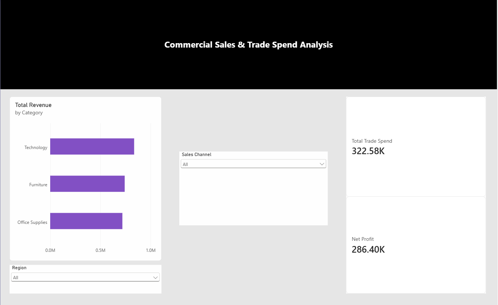
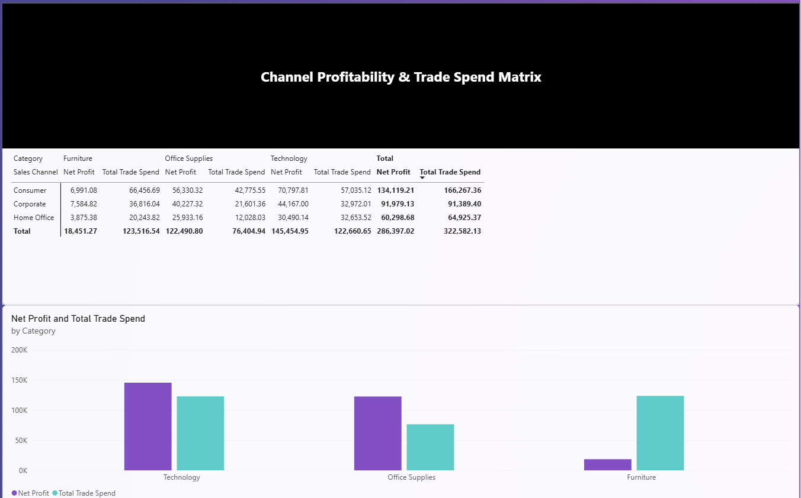
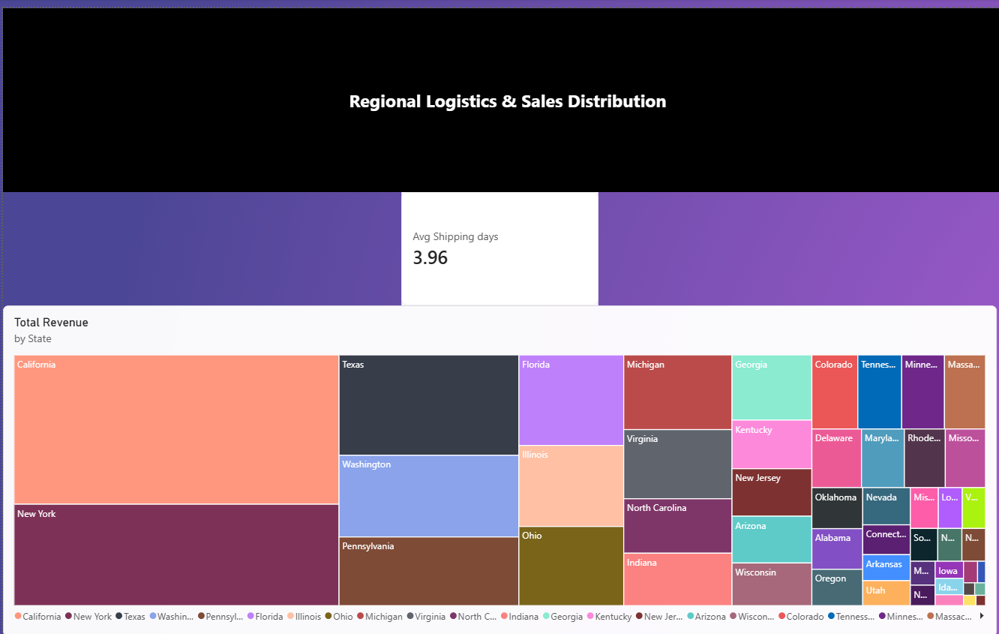

# Commercial-Sales-Trade-Spend-Analysis
## Executive Summary An end-to-end relational data model and interactive Power BI report designed to evaluate promotional trade spend efficiency, channel profitability, and regional logistics turnaround times.
### Key Business Findings - **Margin Leak Identified: ** Across all commercial segments, promotional Trade Spend ($322.58K) outpaced final Net Profit ($286.40K) by over $36K, signaling aggressive discounting in specific categories. :** Technology drove the highest overall profitability, whereas Furniture suffered severe margin erosion from high promotional markdowns. - **Supply Chain Turnaround:** Maintained a 3.96-day average order-to-ship fulfillment timeline across national territories.
## Technical Architecture - **Data Modeling:** Normalized 6,400+ transactional records into a Star Schema (`Fact_Sales` connected to `Dim_Product`, `Dim_Customer`, and `Dim_Location`). - **Custom DAX Measures:** Engineered `Total Trade Spend`, `Net Profit`, and `Avg Shipping Days`.
## Dashboard Preview 
### Page 1: Executive Overview 
 
### Page 2: Channel Profitability & Trade Spend Matrix 
 
### Page 3: Regional Logistics & Sales Distribution 

